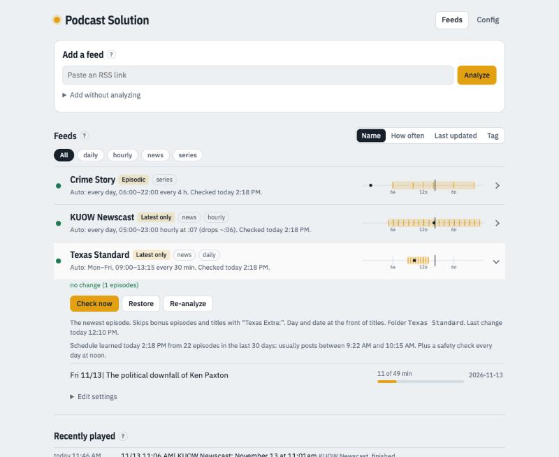

# Podcast Solution

> Part of **[pwnkw_ha](../../)** — Kenneth's collection of Home Assistant projects.
>
> **Status: v1.0** — new (November 2026); running on a Synology NAS beside Plex, feeding Sonos. See [Known limitations](#known-limitations).

Podcasts on Sonos, without a podcast app. You give it RSS links; it keeps each show as an
**album in Plex**, current to the latest episode, and you favorite that album in Sonos once.
Press the favorite any morning and you hear today's episode.



It's a small container (Python, one file) with a web page for managing feeds. It doesn't
need Home Assistant, but it was built to sit beside it: Home Assistant (or Sonos itself)
plays the Plex album on whichever speaker you like.

## How it works

```
RSS feed ──► Podcast Solution ──► episode files in a Plex music folder ──► Plex album ──► Sonos favorite
              (checks on a schedule,     (tagged: album = feed name,
               downloads, tags)           track numbers, artwork)
```

- Each feed becomes a folder, and so an album, in a Plex music library.
- **Latest only** feeds (news, daily shows) swap the newest episode in under fixed file
  names, so Plex keeps the same tracks and your Sonos favorite keeps working.
- **Episodic** feeds (a series you're working through) add new episodes in order. When
  Plex says you've played one (about 90 % through), it moves to a `<name> - Played`
  album and is deleted after the days you choose.
- After each change the app asks Plex to rescan just that folder.

## Features

- **Analyze before adding.** Paste a link; it reads the feed and suggests settings: how
  often the show posts and when, bonus/trailer episodes to skip, Latest only or Episodic,
  artwork, and exactly which episodes the first check would take. Leave the name blank and
  it uses the show's title.
- **Auto schedule.** Learns when a show posts (days, time window, last 30 days, refreshed
  daily) and checks around then, plus once at noon. An hourly newscast that always drops at
  the same minute is checked a minute after the drop, with a few quick retries if it's late.
  Feeds that keep only their newest episode are watched every 15 minutes until the app has
  seen enough posts to learn their rhythm. Manual schedules are there too.
- **Clean titles.** An optional stamp at the front of each title (`11/13 11:01 AM| …`,
  `Fri 11/13| …`, `2026-11-13| …`), and *Tidy titles* drops a leading show name and avoids
  repeating a date the title already carries. The show is always the feed's own title —
  never a host or reporter from the episode's author field.
- **Artwork** from your own link, the feed, or Apple's podcast directory — embedded in each
  file and saved as the album cover.
- **Skip rules**: episodes labelled bonus or trailer, or titles containing given words.
- **Plex play tracking**: each episode shows *Played*, a resume bar (*11 of 49 min*) or
  *Not played*, plus a *Recently played* list. A Latest only swap resets the Plex track to
  unplayed so yesterday's play doesn't stick to today's episode.
- **Restore** downloads again anything you deleted; deleted files otherwise stay deleted.
  **Start over** clears a feed and begins again. **Renaming** a feed moves its folders and
  re-tags its files; Config lists any **stray folders** with a Delete button.
- **Tags** for your own organising (kept in the app, not sent to Plex), with a filter bar
  and a sort that groups the list into collapsible sections by tag.
- **Themes**: four, each light and dark, plus your own accent colour.
- A small JSON API: `GET /api/status`, `GET /api/plays`, `POST /api/check` (`name=<feed>`).

## Requirements

- Docker with Compose (runs on Synology DSM 7 with Docker 24; any Linux Docker host should do).
- A **Plex** server with a **music** library whose folder the container can write into.
- **Sonos** with Plex added as a service (for playing on Sonos). Any Plex client works too.
- A **Plex token** if you want rescans and play tracking
  ([how to find it](https://support.plex.tv/articles/204059436-finding-an-authentication-token-x-plex-token/)).

## Install

1. Pick (or create) a folder inside a Plex music library, for example
   `/srv/music/Podcasts`. If you like, make it its own Plex music library.
2. Copy this folder to the machine that will run it, for example `/opt/podcast-solution`.
3. `cp docker-compose.example.yml docker-compose.yml` and change the four marked lines:
   the file owner (`user`), your time zone, and the podcast folder (twice — the volume and
   `MEDIA_HOST_PATH`, which is that same folder as your NAS names it).
4. `docker compose up -d --build`
5. Open `http://<host>:8095`, go to **Config**, paste your Plex token and address, and press
   **Save and test**. It finds the Plex library that holds the folder on its own.
6. Back on **Feeds**, paste an RSS link and press **Analyze**, then **Add feed**.
7. In the Sonos app, find the album under Plex and add it to My Sonos.

To update later: replace `app.py`, then `docker compose up -d --build`. Feeds, history and
settings live in `./data` and carry over.

## Feed settings

| Setting | What it does |
|---|---|
| **Kind** | *Latest only* keeps just the newest episode(s). *Episodic* keeps every new episode until you've played it. |
| **Takes** (Latest only) | Newest of each show, newest N, or every episode from the latest day (for shows posted in segments). |
| **Start with the newest** (Episodic) | How many existing episodes to begin with; older ones are left alone. Raising it later fetches the extra ones. |
| **Skip** | Episodes labelled bonus/trailer, and titles containing words you list. |
| **Title** | Stamp style, and *Tidy titles*. |
| **Artwork** | The show image on every episode, each episode's own, or an image link you give. |
| **Schedule** | *Auto* (learned) or *Manual* (your days, start, end, every N minutes). |
| **Tags** | Your own labels for the list. |

## Files and data

```
podcast-solution/
├── app.py                       # the whole app: scheduler, downloader, tagger, web page
├── Dockerfile                   # python:3.13-slim + mutagen + tzdata
├── docker-compose.example.yml   # copy to docker-compose.yml and edit
└── data/                        # created on first run — feeds.json, state.json, settings.json
                                 # (your Plex token), plays.json, art/
```

The episode folder looks like this:

```
Podcasts/
├── Morning News/          morning-news-1.mp3, cover.jpg          (Latest only)
├── Some Series/           2026-11-04-episode-title.mp3, …        (Episodic, up next)
└── Some Series - Played/  …                                      (played, kept N days)
```

## Known limitations

- **No login on the page.** Keep it on your home network; don't put it behind a public
  reverse proxy.
- **Sonos and Plex playlists/new items.** Sonos reads Plex through Plex's cloud, and users
  have reported newly added Plex tracks taking a while to play on Sonos. Latest only avoids
  this by reusing the same tracks; brand-new Episodic episodes may lag.
- **Plex "played" means about 90 %.** Stop near the end and an episode may be counted as
  played; it's in the Played album, newest first.
- **Synology Container Manager** shows an error on the details page of a container started
  from the command line. Stop/Restart still work; or create it as a Container Manager
  *Project* on the same folder instead.
- **Playlist aggregators** (for example Listen Notes playlists) work, but tend to lag the
  shows' own feeds; direct show feeds are fresher.
- Ad removal isn't included. Tools like MinusPod or Podly publish an ad-free RSS feed that
  you can point a feed at.

## Changelog

- **1.0.0** — first public version.
